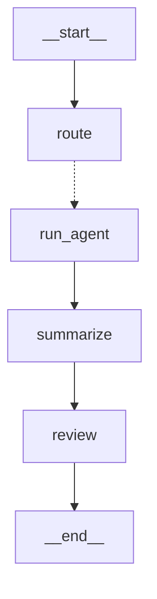
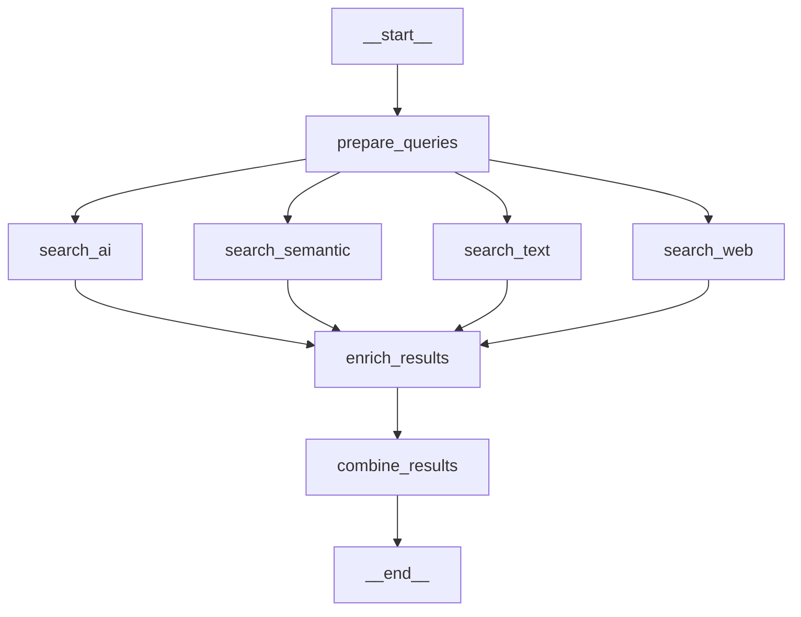

# AI Research Agent

As an AI research engineer, when I start a new project or research a topic, I look for papers, models, datasets, blogs, and existing implementations to understand what is available and what might be useful. This got me thinking: could I automate this part of my work with an AI agent? That was the idea behind this project.

The project takes a research question, searches for relevant resources, reads available source material, and brings the findings together into a report with source links. It uses **specialist agents** to cover different parts of the question and combines their work into one answer, with supporting evidence and any gaps identified during the research.

## Installation

The project requires **Python 3.14 or newer** and `uv` for dependency and virtual environment management.
Run the following commands from the project directory to install the dependencies and set up the environment file:

```bash
uv sync
cp -n .env.example .env
```

- Add `OPENAI_API_KEY` and `ANTHROPIC_API_KEY` to `.env` for LLM usage. The Anthropic key enables the **optional reviewer**.
- For search tools that require credentials, create API keys on the respective providers' websites and add them to the `.env` file.

## Usage

Pass the research question as a quoted command-line argument. The master agent selects the relevant specialists based on your question:

```bash
uv run python agent.py "Find models, papers, datasets, and code for open-vocabulary segmentation."
```

You can also call the agent from Python:

```python
import config
from agent import MasterResearchAgent

config.configure_logging()

agent = MasterResearchAgent()
answer = agent.run(
    "Find models, papers, datasets, and code for open-vocabulary segmentation."
)
print(answer)
```

The agent returns a Markdown answer with findings, source links, and any material uncertainty. In async applications or notebooks, use `await agent.arun(question)`.

Include requirements such as annotation type, license, or deployment environment in your question. These guide the specialists' assignments and the relevance checklist used during synthesis.

## Agents

The master selects between one and four specialists based on the question. All specialists inherit from `ResearchAgent`, which handles query preparation, source extraction, and synthesis. Its search stage has four parallel branches:

1. **Text search** - keyword and fielded searches through **Kaggle**, **arXiv**, or **GitHub**.
2. **Semantic search** - natural-language discovery through **Hugging Face** and **OpenAlex**.
3. **Web search** - Google results and snippets through **Serper**.
4. **AI search** - **Tavily** web results and **Gemini** responses grounded in Google Search.

Each specialist configures its own providers and leaves unused branches empty. The agents have the following roles:

- **Master agent** - breaks the question into focused assignments and creates a relevance checklist. After the specialists finish, it combines their findings and supporting evidence into one answer. The checklist covers both what to include and what to exclude or qualify.
- **Dataset agent** - looks for datasets and evidence about annotations, coverage, access, and licensing. Its instructions distinguish versions, subsets, and annotation variants rather than treating similarly named datasets as interchangeable.
- **Model agent** - searches for pretrained models and evidence about capabilities, checkpoints, licensing, and deployment requirements. It is instructed to leave undocumented hardware requirements or benchmarks unknown.
- **Paper agent** - looks for academic methods and findings through arXiv, OpenAlex, and web search. It distinguishes information available in an abstract from information obtained from the paper's text.
- **Code agent** - searches GitHub repositories and matching source files, supplemented by web search. It collects documentation and implementation excerpts with repository, file, and revision details. Retrieved code is not executed.
- **Claude reviewer** - checks the master draft for unsupported claims, citation mismatches, and missing information. It can choose any registered search tool for up to three follow-up calls, within a 100-second total review deadline. A failed or unavailable review leaves the validated draft in place.

These roles guide the models' work; they do not guarantee that every requested property will be found or verified.

## Tools

Search providers cover different kinds of evidence. Repository and paper APIs expose resource-specific metadata, while web searches can find documentation, model cards, project pages, and related material.

- **Hugging Face:** `search_huggingface` discovers datasets and `search_models` discovers models through the community Hub Search API. These are semantic searches that accept natural-language descriptions.
- **Kaggle:** `search_kaggle` and `search_kaggle_models` perform keyword searches for datasets and models. Both require `KAGGLE_API_TOKEN`.
- **arXiv:** `search_arxiv` searches paper metadata and abstracts using arXiv's fielded and Boolean query syntax. It does not require an API key.
- **OpenAlex:** `search_openalex` performs semantic paper search and reconstructs abstracts when available. `OPENALEX_API_KEY` is optional in the application.
- **GitHub:** `search_github` retrieves repositories and README excerpts; `search_github_code` retrieves matching file excerpts. `GITHUB_TOKEN` is optional for repository search and required for code search.
- **Serper:** `search_serper` retrieves Google search results and snippets. It requires `SERPER_API_KEY` and is used by the dataset, model, and paper specialists.
- **Tavily:** `ai_search`, registered as `tavily_search`, retrieves web results and supporting text. It requires `TAVILY_API_KEY` and initializes on first use.
- **Gemini:** `search_gemini` uses Google Search grounding and retains source evidence from the response. It requires `GEMINI_API_KEY` or `GOOGLE_API_KEY`.

All four specialists use Tavily and Gemini alongside their other providers. Once a specialist is selected, it runs its configured searches. Query preparation adapts the query text to each provider; it does not dynamically select tools or populate their optional filter arguments.

## Flow

A master run follows a fixed sequence, with parallel work inside the specialist and search stages:

1. **Plan the research** - One LLM call selects the specialists, assigns their questions, and generates the shared relevance checklist. The plan is validated so each supported specialist appears at most once.
2. **Prepare the searches** - Selected specialists start in parallel. Each prepares all its provider queries in a single LLM call, using the providers' query guidance.
3. **Collect the evidence** - Search branches run concurrently. Responses are normalized into resources with IDs, URLs, metadata, and source evidence. Failed calls are retained as error results.
4. **Read the sources** - The application fetches result URLs and extracts available HTML or PDF content. Specialists share a cache within the run, so the same URL does not need to be fetched separately for each agent.
5. **Synthesize the findings** - Each specialist makes one synthesis call using its collected evidence and the checklist. The master then receives the checklist, structured findings, and full normalized tool results for its own synthesis call.
6. **Review the answer** - If configured, Claude receives the original question, specialist evidence, and master draft. It can call any registered search tool if needed, up to three times in total, before returning a revised answer.

## Architecture

The project uses a multi-agent **orchestrator–worker pattern** built with LangGraph. The master uses **`Send`** to dispatch selected specialists in parallel (**fan-out**), then gathers their results for synthesis (**fan-in**) and optional review. The implementation is organized into a small set of modules:

- [agent.py](agent.py): specialist and master LangGraph workflows.
- [tools.py](tools.py): provider requests, query guidance, and result preparation.
- [utils.py](utils.py): HTTP sessions, retries, LLM deadlines, normalization, and content extraction.
- [schemas.py](schemas.py): validated plans, resources, tool results, and findings.
- [reviewer.py](reviewer.py): Claude review and bounded follow-up tool execution.
- [config.py](config.py): environment-backed settings, logging, and prompts.
- [debug.py](debug.py): run capture and artifact writing.

### Master graph

The master dispatches one `run_agent` task per selected specialist. The dotted edge represents conditional routing.



### Specialist graph

Each specialist uses this shared graph with its own providers; unused search branches return no results. The reviewer's follow-up tool calls happen inside the `review` node and are not separate graph nodes.



## Features

Beyond finding resources, the application reads source material, keeps track of evidence, and records each run so you can review the results. It also handles common failures so research can continue when possible.

### Evidence and sources

Specialist findings are linked to the resources that support them. The application keeps source links, search snippets, abstracts, and extracted page content so you can see what was available when the answer was written. It checks that specialist findings refer to resources in the search results, although that check alone cannot guarantee every claim is correct.

### Web and PDFs

The application reads available web pages and extracts text from PDFs to give the agents more context than search snippets alone. It reads up to the **first 40 pages and 50,000 characters** of a PDF. Scanned pages and complex tables may not be fully captured. If a page cannot be read, the original search evidence is still available.

### Parallelism and records

Selected specialists and their searches run in parallel, with up to five source pages processed at once. Each run is **saved by default**, including its searches, extracted content, findings, and final answer. These records make it easier to review the sources behind an answer or investigate what happened when part of a run fails.

### Failures and limits

Some temporary HTTP failures are retried, with up to four attempts. Search calls time out after 60 seconds (100 for Gemini), routing and synthesis after 180 seconds, and page processing after 20 seconds or 5 MB of downloaded content. There is **no overall run deadline**. Other searches can continue if a tool fails. If specialist synthesis fails, its search results remain in saved runs but are **not passed to the master**. A failed review falls back to the draft; routing or master synthesis failures stop the run.

## Configuration

Model settings, prompts, extraction limits, and timeouts live in [config.py](config.py). Common runtime overrides are available through `.env`:

```dotenv
OPENAI_MODEL=gpt-6-luna
ANTHROPIC_MODEL=claude-haiku-5-5
SAVE_RUNS=true
LOG_LEVEL=INFO
# RUNS_DIR=runs
```

- Planning and synthesis use the OpenAI Responses API. Reasoning effort is low for planning, high for specialist synthesis, and xhigh for master synthesis.
- Gemini search uses `gemini-3.8-flash`, set through the `GEMINI_SEARCH_MODEL` constant in `config.py`.

## Logging

The command-line entry point logs progress through routing, searches, source reading, synthesis, and review. Log messages include a run ID, making it easier to follow work from parallel agents. Python callers can enable logging with `config.configure_logging()`.

- Runs are saved under `runs/` by default, including queries, search results, extracted content, findings, and the final answer. Completed results remain available if a run fails.
- `LOG_LEVEL` controls log detail and defaults to `INFO`.
- Set `SAVE_RUNS=false` to disable saving, or `RUNS_DIR` to change the output directory.

